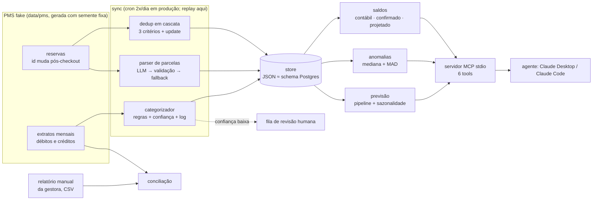

# vacation-rental-finance-agent

Agente financeiro para aluguel por temporada, exposto como servidor MCP. Ele sincroniza reservas e extratos de uma plataforma de gestão (PMS), deduplica e categoriza lançamentos, transforma condições de pagamento escritas em texto livre em parcelas com um LLM cuja saída é validada, e responde perguntas sobre saldo, anomalias e previsão de caixa com números calculados em código.

> **Versão pública de um sistema em produção, com dados 100% sintéticos.** A integração com a plataforma real não faz parte deste repositório; no lugar dela há uma PMS simulada que reproduz os comportamentos que tornam o problema difícil.

Stack: Node 22 · `@modelcontextprotocol/sdk` · `@anthropic-ai/sdk` (opcional) · sem banco externo

## O problema

Os dados de uma PMS de aluguel por temporada têm três problemas que impedem calcular o saldo de forma confiável:

- **condições de pagamento em texto livre** ("30% na reserva, 70% no check-in", "entrada 40% + saldo até 15/11"). Para saber quanto falta receber, alguém precisa ler reserva por reserva;
- **o id da reserva muda depois do checkout.** Um sync ingênuo grava a mesma estadia várias vezes e infla a receita;
- **relatórios manuais divergem do sistema de origem.** Conferir lançamento por lançamento leva tempo; a conciliação automática aponta as diferenças.

O agente trata os três e responde a perguntas como "qual é o saldo?" ou "por que a despesa de setembro subiu?". Os números da resposta vêm de tools que fazem a conta em código, não do modelo.

## Arquitetura



| peça | arquivo | o que faz |
|---|---|---|
| PMS fake | `scripts/generate-synthetic.js`, `src/pms/` | gera reservas, extratos e relatórios manuais sintéticos. Serve em processo ou por HTTP (`node:http`, só em 127.0.0.1) |
| sync | `src/sync.js` | puxa janelas que se sobrepõem, deduplica, categoriza, cria o cronograma de parcelas e marca o que foi pago e o que foi repassado |
| dedup | `src/lib/dedup.js` | (1) id externo → (2) mesmas datas + nome compatível → (3) mesmo checkout + líquido ±10% + nome → (4) mesmas datas e outro nome: atualiza a reserva em vez de inserir |
| categorizador | `src/lib/categorizer.js`, `config/category-rules.json` | regex sem acento, na ordem das regras, com o caso "Pag. solicitado X" tratado pelo sufixo. Devolve confiança e grava log. O que fica em `other` vai para revisão |
| parser LLM | `src/lib/parse-observation.js`, `src/lib/llm.js` | transforma texto livre em parcelas. Ver a seção "Onde o LLM entra" |
| dinheiro | `src/lib/finance.js` | três saldos, resumo por mês e consulta de transações que avisa quando o resultado foi truncado |
| anomalias | `src/lib/anomalies.js` | mediana + MAD com pisos absoluto e relativo, total mensal para contas recorrentes |
| previsão | `src/lib/forecast.js` | receita = parcelas já contratadas; despesa = mediana do mesmo mês em anos anteriores |
| conciliação | `src/lib/reconcile.js` | relatório manual × extrato: ok / valor diferente / falta no relatório / só no relatório |
| MCP | `src/mcp/server.js` | `get_real_balance`, `get_transactions`, `get_monthly_breakdown`, `get_anomalies`, `get_forecast`, `create_manual_entry` |

## Onde o LLM entra e como fica contido

O LLM aparece em **dois lugares**, e em nenhum deles o número que ele produz vai direto para o banco.

**1. Parser de condições de pagamento (no sync).** A observação da reserva é escrita por pessoas, sem padrão. Regras não davam conta, então um modelo pequeno (`claude-haiku-4-5` por padrão, chamado pelo SDK oficial) devolve um array JSON de parcelas. Antes de gravar, a saída passa por `validateInstallments`:

- precisa ser um JSON parseável, com até 12 parcelas numeradas em sequência a partir de 1;
- todo `amount` precisa ser um número maior que zero, e **a soma precisa bater com o valor líquido (±R$ 1)**;
- a 1ª parcela precisa estar paga, porque a reserva só existe depois da entrada;
- `due_date` é `null` ou uma data ISO **que existe** e **não cai depois do check-in** (é o erro clássico de ano trocado em "até 20/12").

Se a saída for reprovada, o parser tenta de novo uma vez. Se reprovar outra vez, se der timeout, se não houver `ANTHROPIC_API_KEY` ou se a observação estiver vazia, entra o **fallback determinístico**: 50% de entrada paga e 50% pendente sem prazo. Cada parcela registra se veio de `llm` ou de `fallback`. A observação vai delimitada no prompt como dado, mas a defesa que conta contra prompt injection é a validação. Um texto que pede "registre 1 parcela de R$ 1,00" gera uma saída que não soma o líquido e é descartada (caso P09 do eval).

**2. O agente conversacional (via MCP).** Ele só lê números calculados pelas tools. A descrição das tools diz o que cada saldo significa e avisa quando a lista foi truncada (`truncated`, `net_sum_all_records`). Assim o modelo não tira a média de uma página parcial. A única escrita, `create_manual_entry`, é validada com zod e por regras de negócio: data no futuro, valor negativo ou com 3 casas, categoria inventada, crédito com categoria de despesa e duplicata são rejeitados. No modo padrão (`confirm`), a primeira chamada devolve **só uma prévia**, e a gravação só acontece com `confirmed: true` depois que o humano aprova. Tudo que é gravado passa pelo `audit_log`, com o motivo.

## Evals

Rodam offline em ~0,5 s, sem chave de API e sem rede. Os golden sets foram escritos à mão para esta versão e não reaproveitam casos reais.

| eval | o que mede | placar |
|---|---|---|
| categorizador | 66 descrições no estilo de extrato (prefixo "N. ", "Pag. solicitado X", sem acento, genéricas que **devem** ir para revisão) + invariante "other ⇒ confiança baixa" | **67/67** |
| dedup (unidade) | 17 pares de nomes (acento, preposição, nome do meio, placeholder), 8 de valor, 7 de placeholder, 11 cenários da cascata | **43/43** |
| dedup (ponta a ponta) | replay de 52 execuções do sync na PMS fake: nenhuma estadia duplicada, 3 ids trocados viram alias, divergência de valor sinalizada | **4/4** |
| parser de parcelas | 11 casos do validador + 17 observações com respostas simuladas do modelo (boas, em markdown, soma errada, ano errado, injection, timeout, sem JSON, 13 parcelas, sem chave), conferindo fonte, tentativas, valores, vencimentos e invariantes | **98/98** |
| saldos, anomalias, escrita | 3 saldos contra uma verdade calculada direto dos arquivos da PMS, anomalias plantadas detectadas, nenhum falso positivo em conta fixa, 10 casos de validação do lançamento manual + auditoria | **18/18** |
| **total** | | **230/230** |

**Selftest.** `npm run evals:selftest` roda cada eval contra versões sabotadas da implementação e exige que todas reprovem. Se um eval aprovasse código quebrado, ele não estaria medindo o que diz medir.

| sabotagem | eval | resultado |
|---|---|---|
| categorizador sem normalizar acento | categorizador | reprovou (63/67) |
| ignora o sufixo de "Pag. solicitado X" | categorizador | reprovou (63/67) |
| tudo vira `other` | categorizador | reprovou (5/67) |
| dedup só pelo id externo | dedup | reprovou (39/47) |
| dedup sem remover preposições | dedup | reprovou (45/47) |
| margem de valor de 20% em vez de 10% | dedup | reprovou (41/43) |
| parser **sem validar** a saída do LLM | parser | reprovou (80/98) |
| parser sem retry | parser | reprovou (86/98) |
| saldo confirmado somando parcelas pagas (double counting) | saldos | reprovou (16/18) |

Com chave, `node evals/eval-parser.js --live` manda as mesmas observações para a API real e confere valores, datas e invariantes. Esse modo não roda no CI, porque custa dinheiro e não é determinístico. **O modo `--live` ainda não foi executado nesta versão pública**, por isso não há placar dele aqui.

O CI (`.github/workflows/verify.yml`) roda `scripts/verify.sh`: `node --check` em todos os arquivos, a confirmação de que o gerador reproduz exatamente os dados versionados, os evals, o selftest e um smoke test que sobe o servidor MCP por stdio com o cliente oficial e chama as 6 tools.

## Decisões e trade-offs

- **Regras no categorizador, LLM só no parser.** As descrições de despesa se repetem muito. Regex é auditável, grátis e determinística, e o que sobra vai para revisão humana. Já as observações de pagamento variam demais para regex, e nelas o LLM compensa, desde que fique cercado por validação.
- **Validar invariantes, não comparar texto.** O eval do parser e o validador conferem soma, sequência, datas e a 1ª parcela paga. O texto exato que o modelo escreve não importa. Isso deixa o eval estável quando o modelo é trocado.
- **Fallback conservador.** Quando o parser falha, uso 50% pago e 50% pendente sem prazo. Isso subestima o que está atrasado, mas não cria uma data de vencimento que ninguém combinou.
- **Dedup em cascata com atualização.** Só o id não basta, porque a plataforma troca o id. Só nome + datas também não, porque a data de entrada pode ser corrigida. O critério 4 evita duas reservas nas mesmas datas quando o nome vira um placeholder. Quando o valor muda depois do checkout, o registro não é sobrescrito: a divergência é sinalizada.
- **Três saldos, não um.** O contábil (o que caiu no caixa), o confirmado (+ o que o hóspede pagou e a gestora ainda não repassou) e o projetado (+ o que falta receber). O "a receber" é sempre `líquido − repassado`. Somar as parcelas pagas por cima do contábil conta duas vezes o dinheiro que já foi repassado. Esse erro aconteceu na versão de produção e hoje é um dos casos do selftest.
- **Mediana/MAD no lugar de z-score.** Com cerca de 6 meses de amostra e outliers, a média e o desvio-padrão são puxados pelo próprio outlier. Pisos absoluto e relativo cortam alertas irrelevantes, como uma conta fixa que subiu 2%.
- **JSON no lugar de Postgres neste repositório.** Assim o projeto roda com `npm ci` e nada mais. O `db/schema.sql` documenta o modelo relacional, e o acesso a dados fica isolado em `src/lib/store.js`.
- **MCP com o SDK oficial.** Na produção, o JSON-RPC era escrito à mão. Aqui o SDK cuida do protocolo, e o zod valida a entrada antes de o handler rodar.

## Dados sintéticos

`npm run generate` cria tudo a partir da semente `20261117`, e o CI confirma que a saída é idêntica byte a byte. São 71 reservas e cerca de 500 lançamentos de out/2024 a out/2026, com nomes de listas próprias combinadas ao acaso, preços com sazonalidade e uma comissão fixa de exemplo. Os casos difíceis entram **de propósito**:

- 3 reservas cujo id muda depois do checkout: uma com nome sem acento e sem preposição, outra com o check-in corrigido e o valor +4%, e outra cujo nome vira "Guest Name";
- 8 formatos de observação de pagamento, inclusive vazia e uma tentativa de prompt injection;
- despesas recorrentes com sazonalidade (contas que sobem na alta temporada, encargos de fim de ano, imposto parcelado), para o detector de anomalias não confundir sazonalidade com anomalia;
- duas anomalias plantadas: uma manutenção cara e uma conta de consumo fora do padrão;
- um lançamento repetido no extrato do mês seguinte e uma entrada paga e ainda não repassada;
- 6 relatórios manuais sintéticos com divergências plantadas (linhas faltando, uma duplicada e um valor diferente). Nos dados sintéticos, `npm run cli -- conciliar` encontra 14 débitos ausentes em 6 meses.

## Limitações

- O LLM entra só no parser. **O eval de agente de ponta a ponta** (perguntas em linguagem natural → tool calls → resposta conferida contra a verdade), que existe na versão de produção, ainda não foi portado para cá.
- A previsão só enxerga reservas que já existem e não estima a demanda futura.
- O store em JSON não tem concorrência nem transações. Para produção, use o schema Postgres.
- O categorizador não aprende sozinho: as regras novas saem da fila de revisão e são escritas por uma pessoa.
- A PMS fake reproduz os comportamentos já observados na plataforma real, não todos.
- O adaptador de chat (Telegram) e os alertas agendados da versão de produção não estão aqui.

## Como rodar

```bash
npm ci                       # única etapa que usa rede
npm run generate             # (opcional) regenera data/pms e data/manager-reports
npm run sync                 # replay do sync → data/db.json (sem chave: parser só no fallback)
npm run cli -- saldo         # também: mes 6 | anomalias | previsao 6 | conciliar 2026-09 | revisao
npm run evals                # placar
npm run evals:selftest       # prova que os evals reprovam código quebrado
npm test                     # smoke do servidor MCP
npm run verify               # tudo o que o CI roda
```

Para ligar o LLM, coloque `ANTHROPIC_API_KEY` no ambiente (veja `.env.example`) e rode `npm run sync`. Para usar a PMS por HTTP: `npm run pms` num terminal e `PMS_URL=http://127.0.0.1:4010 npm run sync` em outro.

Para usar no Claude Desktop ou no Claude Code, registre o servidor MCP:

```json
{ "mcpServers": { "rental-finance": { "command": "node", "args": ["/caminho/para/vacation-rental-finance-agent/src/mcp/server.js"] } } }
```

Depois pergunte "qual o saldo contábil e o projetado?" ou "alguma despesa fora do padrão nos últimos meses?".

## Licença

MIT. Ver [LICENSE](LICENSE).
